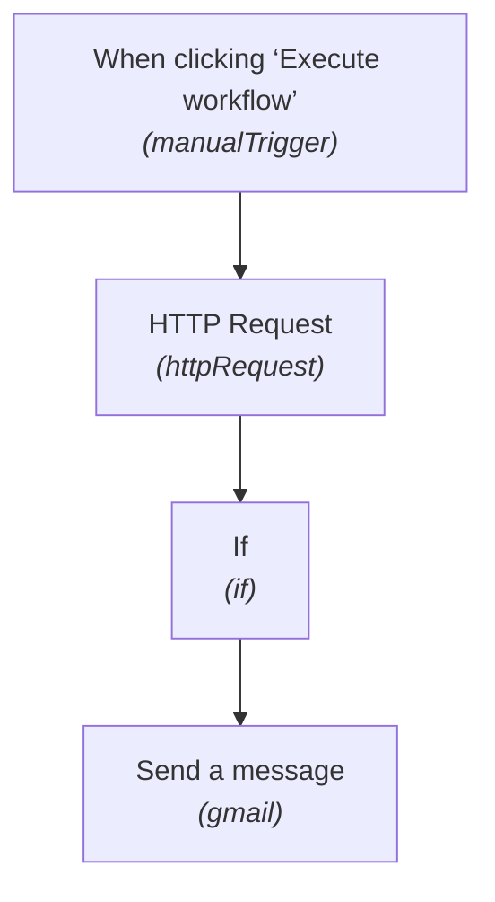

# ⚡ Weather Alert Automation via REST API

[](https://n8n.io)
[](#)
[](#)
[](#)

> **Workflow Sequence #06** in the [Maheen Azhar n8n Workflow Collection](https://github.com/maheenazhar/n8n-workflows-collection).

---

## 📖 Overview

Fetches real-time meteorological conditions from an external Weather REST API, evaluates environmental criteria via an IF node, and triggers urgent Gmail alerts when severe conditions occur.

### 🎯 Key Use Case
Automated operational warnings for logistics, outdoor construction, agricultural operations, or event planning.

---

## 🏗️ Architecture & Flow



---

## 🧩 Nodes in this Workflow

| # | Node Name | Type | Version |
|---|-----------|------|---------|
| 1 | **When clicking ‘Execute workflow’** | `n8n-nodes-base.manualTrigger` | v1 |
| 2 | **HTTP Request** | `n8n-nodes-base.httpRequest` | v4.5 |
| 3 | **If** | `n8n-nodes-base.if` | v2.3 |
| 4 | **Send a message** | `n8n-nodes-base.gmail` | v2.2 |

---

## 🔑 Prerequisites & Credentials

Before running this workflow, ensure you have the following configured in your n8n environment:

- [ ] **Free Weather API endpoint (OpenWeatherMap / WeatherAPI)**
- [ ] **Gmail credential**

> [!NOTE]
> All credentials are decoupled from this export file for security. When importing into your n8n workspace, re-assign your local credentials in the respective node configuration panels.

---

## 🚀 Setup & Installation

1. **Clone or Download:**
   ```bash
   git clone https://github.com/maheenazhar/n8n-06-weather-alert-automation.git
   cd n8n-06-weather-alert-automation
   ```
2. **Import into n8n:**
   - Open your n8n canvas.
   - Click the top-right menu `...` -> **Import from File**.
   - Select `workflow.json` from this repository.
   - *(Alternative)*: Open `workflow.json`, copy the entire JSON contents, and paste directly (`Ctrl+V`) onto the n8n canvas.
3. **Configure Credentials:**
   - Open each integration node marked with a red credential prompt.
   - Select or configure your accounts (e.g., Google OAuth, Groq API, Supabase, SMTP).
4. **Activate / Test:**
   - Click **Test step** or **Execute Workflow** to verify end-to-end functionality.
   - Toggle the workflow to **Active** for live production use.

---

## 📄 File Structure

```
06-weather-alert-automation/
├── workflow.json   # Full exportable n8n workflow definition
├── README.md       # Comprehensive documentation and architecture
└── .gitignore      # Standard Git exclusions
```

---

## 👤 Author & Repository

- **Author:** [Maheen Azhar](https://github.com/maheenazhar)
- **Workflow ID:** `WkCZBW7X8kaI1q4A`
- **Created Date:** `2026-10-08 05:32:00.291`
- **Last Modified:** `2026-10-08 05:51:32.473`
- **Repository:** [`https://github.com/maheenazhar/n8n-06-weather-alert-automation`](https://github.com/maheenazhar/n8n-06-weather-alert-automation)

---

*Part of the [n8n Workflows Collection](https://github.com/maheenazhar/n8n-workflows-collection) by Maheen Azhar.*
